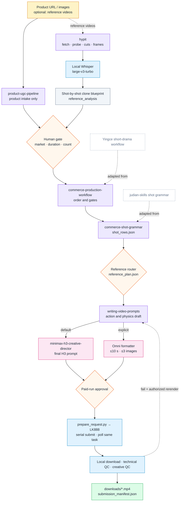

[简体中文](README.md) · **English**

<p align="center"></p>

<p align="center">
  <a href="LICENSE"></a>
  
  
  
  
</p>

AdMuse is an Agent Skill orchestration workflow. It routes a product link and optional reference videos through a set of single-purpose skills, producing 9:16 product videos with a faithful product look and correct cause-and-effect actions, then downloads and checks each render locally.

It is not a video model itself. It calls MiniMax H3 by default and Omni Flash (up to 10 seconds per clip) when you ask for it explicitly.

## Quick start

```bash
git clone https://github.com/peipeijiang/ad-muse.git
cd ad-muse
python3 install.py --check   # report only, install nothing
python3 install.py           # add missing skills, skip existing ones
```

Then invoke it in Codex or Claude Code:

```text
$ad-muse Make 5 Mexican-Spanish videos from this 1688 link, 15 s, 9:16, 768P.
Reference videos: https://www.tiktok.com/@xxx/video/123, https://www.tiktok.com/@yyy/video/456
```

Paid generation uses your own LK888/upDrama account, with keys supplied through environment variables (`LK888_API_KEY`; product-image analysis uses `LAOZHANG_API_KEY`). Without paid-run approval, AdMuse stops at reviewable prompts and request files.

## Workflow



Each stage owns one canonical file, and downstream stages annotate it instead of writing a second copy: one product brief, one `shot_rows.json`, and one `model_prompt.md` per variant. Storyboards, previs and identity images are created only when needed; otherwise the manifest records `not_required` with a reason.

## Reference-video recreation

When reference videos are supplied, AdMuse reads them before writing any creative:

- **Download and cuts**: hypit fetches the video, probes duration and framing, proposes candidate cuts and extracts frames; the real edit points are then confirmed by inspection.
- **Speech**: the locally installed Whisper `large-v3-turbo` transcribes the original language with segments, word timings and probabilities. No model is downloaded automatically.
- **Shot blueprint**: every shot records timing, shot size, framing, camera angle, composition, camera movement and speed, focus, light direction, transition, dialogue, ambience and on-screen text, plus what to keep and what to replace.
- **Allocation**: with N references and M requested videos, each reference gets ⌊M/N⌋ videos and the first M mod N references get one more; if M < N, only the first M are used. Ten references and twenty videos means two videos per reference.

## Reference routing

<p align="center"></p>

For each variant the router picks the smallest reference set that still preserves the product look and the action (workflow illustration):

| Mode | Use when |
|---|---|
| `product_images_only` | Source images show the product clearly, it stays in one state, and the action is obvious |
| `identity_plus_product` | Geometry is easy to confuse, several sides are visible, or parts change state |
| `storyboard_plus_product` | Several meaningful shots, or a reveal/proof sequence that text alone will not hold |
| `full_spatial_reference` | Hand contact, installation, axis, light/air/spray direction or complex camera geometry matters |

If a generated identity image changes the SKU, geometry, orientation or control layout, it is discarded and the verified source image is used instead.

## Model backends

| Backend | Duration | Reference images | Prompt | When |
|---|---|---|---|---|
| `minimax-h3` | 4–15 s, 24 FPS | up to 9 | ≤7000 characters | default |
| `omni-flash` / `omni_flash-10s` | ≤10 s | up to 3 | ≤4000 characters | explicitly selected |

If Omni Flash is selected with a 15-second target, AdMuse neither truncates nor switches models silently; it proposes a multi-clip plan or asks you to adjust the brief.

## Physical-causality constraints

For products with directional output, the prompt spells out the causal chain and geometry. For a bike light: the hand presses the button → the button moves down → only the lamp face emits light → the lit patch sits on the ground or wall in front of the lamp axis. Fans, sprays, screens and magnetic accessories get the same source, direction and receiving-surface constraints.

## Delivery and QC

- **Serial submission**: `submission.json` is written before each request and the task ID is recorded immediately; an ambiguous response triggers a status check, never a duplicate submit.
- **Download**: files land as `.part`, are validated, then renamed to `.mp4` with a recorded SHA-256.
- **Two QC passes**: technical QC checks codec, duration, size, frame rate and audio; creative QC samples opening, action, proof and closing frames for SKU, hands, light direction, language and action order.
- **Separate counts**: submitted, remote-final, downloaded, technical pass and creative pass are reported separately. Technical success is not creative acceptance.

## Dependencies

`install.py` searches `~/.agents/skills` and `~/.codex/skills`. Existing skills are always skipped and never overwritten; missing ones are added to `~/.agents/skills` from the sources below.

| Skill | Role | Source |
|---|---|---|
| `ad-muse` | Orchestrator | this repository |
| `commerce-production-workflow` | Production order, gates, cross-artifact QC | this repository (adapted) |
| `commerce-shot-grammar` | Axis, blocking, camera, contact and state | this repository (adapted) |
| `product-ugc-pipeline` | Product scraping, asset manifest, brief, identity references | [peipeijiang/product-ugc-pipeline](https://github.com/peipeijiang/product-ugc-pipeline) |
| `writing-video-prompts` | Model-neutral action and physics draft | [SupercmoHQ/superCMO-skills](https://github.com/SupercmoHQ/superCMO-skills) |
| `minimax-h3-*` (6) | H3 routing, reference/text/keyframe/multishot prompts and review | [unknowlei/minimax-h3-opencode-skills](https://github.com/unknowlei/minimax-h3-opencode-skills) |
| `h3-prompt-writing` | Official H3 prompt syntax | [MiniMax-AI/MiniMax-H3](https://github.com/MiniMax-AI/MiniMax-H3) |
| `hypit` | Reference-video download and analysis | [hypit-ai/hypit](https://github.com/hypit-ai/hypit) |

Local tools are checked, not installed: `git`, `ffmpeg` and `ffprobe` are required; the `hypit` CLI is used for reference-video mode (`npm install -g @hypit/hypit`); Whisper needs a Python that can `import whisper` and cached weights. Add `--verify-asr-hash` to check the official SHA-256 of large-v3-turbo, or `--json` for machine-readable output.

## License

[MIT](LICENSE). Origins of adapted content and licenses of third-party skills are listed in [NOTICE.md](NOTICE.md).
