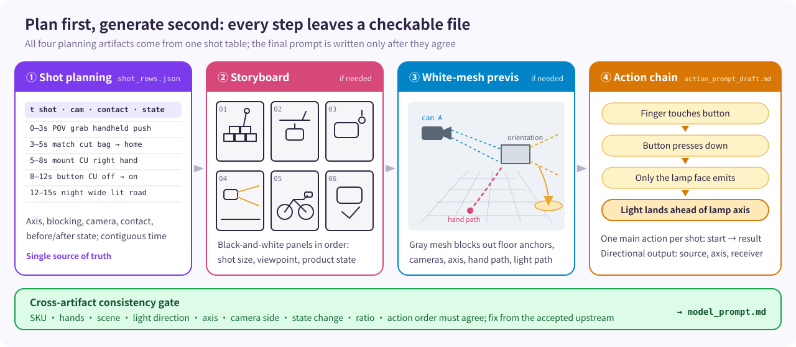
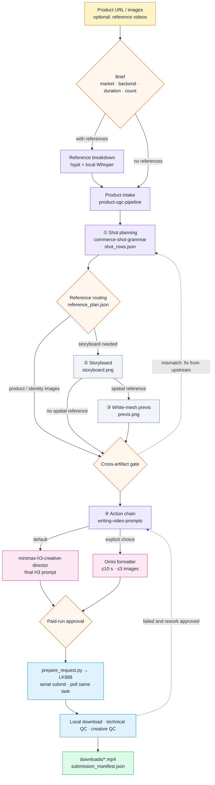

[简体中文](README.md) · **English**

<p align="center"></p>

<p align="center">
  <a href="LICENSE"></a>
  
  
  
  
</p>

> Turn a product link and reference videos into product videos with a faithful look, correct cause-and-effect action, and local QC.

AdMuse is an Agent Skill orchestration workflow; it does not render pixels itself. Before any paid generation, it breaks a video into four checkable planning artifacts: **shot plan, storyboard, white-mesh previs and action chain**. The final prompt is written only after they agree. It calls MiniMax H3 by default and Omni Flash (up to 10 seconds per clip) when you select it explicitly.

<p align="center"></p>

## Highlights

### 1. Shot-by-shot reference breakdown

When you supply reference videos, AdMuse reads them before writing anything. hypit downloads each video, probes duration and aspect ratio, finds candidate cuts and extracts frames; the real edit points are then confirmed against the frames. The local Whisper `large-v3-turbo` model transcribes the original-language speech offline with word timings.

Each shot records start/end time, shot size, aspect and framing, camera angle, composition, camera movement and speed, focus, lighting direction, transition, spoken words, sound and on-screen text, plus what to keep and what to replace with your product.

**Output**: `reference_analysis.json` and `reference_analysis.md`, a shot-by-shot recreation blueprint.

### 2. Shot planning

`commerce-shot-grammar` decides, for every shot, the axis, blocking, camera position and movement, product orientation, which hand touches which part of the product, the product state before and after the action, environment anchors and lighting direction. Shot timings are contiguous and sum to the target duration.

This shot table is the single source of truth. The storyboard, previs and prompts are all derived from it, so there is never a second, conflicting shot list.

**Output**: `shot_rows.json`.

### 3. Storyboard

The shot table is drawn as a black-and-white multi-panel storyboard that lays out shot size, viewpoint, people and product state in time order. It fixes what happens first and what happens next. It is a visual reference and does not replace the shot table.

**Output**: `storyboard.png` (generated when needed).

### 4. White-mesh previs

Untextured gray geometry blocks out the space: floor anchors, product and person placement, hand paths, camera positions, axis and frame safety. The previs inherits the storyboard's SKU, hands, background, camera side, lighting direction and product orientation; it is not a separate drawing.

Previs is generated only when hand-product contact, installation, the direction of light/air/spray or complex camera movement is likely to go wrong. Simple shots skip it.

**Output**: `previs.png` (generated when needed).

### 5. Action chain

`writing-video-prompts` rewrites the shot table as an action and physics draft. Each shot has one main action with a visible start, process and result, in causal order. For a bicycle lamp:

```text
finger touches button → button presses down → only the lamp face emits → the light patch lands on the road ahead of the lamp axis
```

No light may appear from behind the lamp, beside it or from the frame edge. Fans, sprays, screens and magnetic accessories follow the same pattern: source point → orientation → axis → receiving surface → visible result.

**Output**: `action_prompt_draft.md`. It is model-neutral and never submitted directly.

### 6. Cross-artifact consistency gate

Before the final prompt is written, AdMuse compares SKU, hands, scene, lighting direction, axis, camera side, state changes, aspect ratio and action order across artifacts. A conflict is fixed by revising the downstream artifact from the accepted upstream one, never by inventing a third state. When an upstream artifact changes, downstream artifacts are invalidated by revision and hash, so a stale storyboard or prompt is never reused.

### 7. Smart reference routing

Each variant gets one `reference_plan.json` that selects the smallest reference set able to preserve the product look and action. When the product is simple, the source images show it clearly and the action is obvious, a few source images are enough. Identity images, the storyboard or previs are added only for ambiguous geometry or complex action. Unused artifacts are recorded as `not_required` with a reason.

<p align="center"></p>

| Mode | When |
|---|---|
| `product_images_only` | Source images show the product clearly, one simple state, obvious action |
| `identity_plus_product` | Ambiguous geometry, several visible sides, or state-sensitive parts |
| `storyboard_plus_product` | Several meaningful shots, or a reveal/proof sequence text alone won't preserve |
| `full_spatial_reference` | Hand contact, installation, axis, light/air/spray direction or complex camera movement matters |

A generated identity image that changes the SKU, geometry, orientation or control layout is discarded in favor of the verified source images.

### 8. Paid-run safety and two-pass QC

One request at a time: `submission.json` is written before each request and the task ID is recorded as soon as it returns. If the outcome is unclear, AdMuse checks the known task first instead of resubmitting. Downloads go to a `.part` file and are renamed to `.mp4` only after validation, with the SHA-256 recorded.

Technical QC checks codec, duration, dimensions, frame rate and audio. Creative QC samples frames before the action, at contact, at the state change, at the proof result and at the end. Submitted, remote-final, downloaded, technical-pass and creative-pass counts are reported separately; technical success never implies creative acceptance.

## Workflow



| Stage | Owner | Output | Passes when |
|---|---|---|---|
| Brief | `ad-muse` | `pipeline_manifest.json` | Market and language, backend, duration, ratio and count are set |
| Reference breakdown (optional) | `hypit` + local Whisper | `reference_analysis.json`, `transcript.json` | Every shot has timing, camera language and evidence frames |
| Product intake | `product-ugc-pipeline` | `product_brief.json`, `product_reference_set/` | Look, structure, controls and supported states are backed by images or sources |
| Shot planning | `commerce-production-workflow` + `commerce-shot-grammar` | `shot_rows.json` | Contiguous timings; every shot has camera, contact point and before/after state |
| Reference routing | `ad-muse` | `reference_plan.json` | Every selected image has a role, hash and reason |
| Storyboard / previs (as needed) | `commerce-production-workflow` | `storyboard.png`, `previs.png` | Matches the shot table and passes the cross-artifact gate |
| Action chain | `writing-video-prompts` | `action_prompt_draft.md` | One main action per shot, visible causal order |
| Final prompt | `minimax-h3-creative-director` or Omni formatter | `model_prompt.md` | Duration, image count, length and image roles fit the backend |
| Submission | `prepare_request.py` → LK888 | `submission_manifest.json` | Paid run approved; one at a time; same task polled |
| Acceptance | `ad-muse` | `downloads/*.mp4`, `qc/` | Technical and creative QC judged separately |

Reference-to-output allocation: with N references and M requested videos, each reference gets ⌊M/N⌋ outputs and the first M mod N references get one more; when M < N, only the first M are used. For example, 10 references and 20 videos means 2 per reference.

## Quick start

```bash
git clone https://github.com/peipeijiang/ad-muse.git
cd ad-muse
python3 install.py --check   # report only, install nothing
python3 install.py           # add missing skills, skip existing ones
```

Then invoke it in Codex or Claude Code:

```text
$ad-muse Make 5 Mexican-Spanish videos from this 1688 link, 15 s, 9:16, 768P.
Reference videos: https://www.tiktok.com/@xxx/video/123, https://www.tiktok.com/@yyy/video/456
```

Paid generation uses your own LK888/upDrama account, with the key supplied through the `LK888_API_KEY` environment variable. Product-image analysis is done directly by the current agent's multimodal model; no extra vision API or key is needed. Without paid-run approval, AdMuse stops at reviewable planning files, prompts and request files.

## Model backends

| Backend | Duration | Reference images | Prompt | When |
|---|---|---|---|---|
| `minimax-h3` | 4–15 s, 24 FPS | up to 9 | ≤7000 chars | Default |
| `omni-flash` / `omni_flash-10s` | ≤10 s | up to 3 | ≤4000 chars | Explicit choice |

Both backends share the same shot table, product brief and references; only the final prompt, reference selection and request envelope differ. If Omni Flash is selected with a 15-second request, AdMuse does not silently shorten it or switch models; it proposes a multi-clip plan or asks you to adjust the brief.

## Dependencies

`install.py` checks `~/.agents/skills` and then `~/.codex/skills`. Existing skills are always skipped and never overwritten; missing ones are installed into `~/.agents/skills`.

| Skill | Role | Source |
|---|---|---|
| `ad-muse` | Orchestration, reference routing, submission and acceptance | this repo |
| `commerce-production-workflow` | Production order, storyboard and previs, cross-artifact QC | this repo |
| `commerce-shot-grammar` | Axis, blocking, camera, contact and state | this repo |
| `product-ugc-pipeline` | Product scraping, asset manifest, product brief, identity references | [peipeijiang/product-ugc-pipeline](https://github.com/peipeijiang/product-ugc-pipeline) |
| `writing-video-prompts` | Model-neutral action and physics draft | [SupercmoHQ/superCMO-skills](https://github.com/SupercmoHQ/superCMO-skills) |
| `minimax-h3-*` (6) | H3 routing, reference/text/first-last-frame/multishot prompts and review | [unknowlei/minimax-h3-opencode-skills](https://github.com/unknowlei/minimax-h3-opencode-skills) |
| `h3-prompt-writing` | Official H3 prompt grammar | [MiniMax-AI/MiniMax-H3](https://github.com/MiniMax-AI/MiniMax-H3) |
| `hypit` | Reference-video download and analysis | [hypit-ai/hypit](https://github.com/hypit-ai/hypit) |

Local tools are checked, never installed: `git`, `ffmpeg` and `ffprobe` are required; the `hypit` CLI is used in reference-video mode (`npm install -g @hypit/hypit`); Whisper needs a Python that can `import whisper` and cached weights. Add `--verify-asr-hash` to check the official large-v3-turbo SHA-256, or `--json` for machine-readable output.

## License

[MIT](LICENSE). Third-party skill sources and licenses are listed in [NOTICE.md](NOTICE.md).
