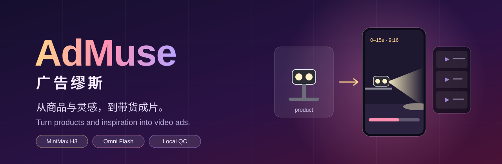
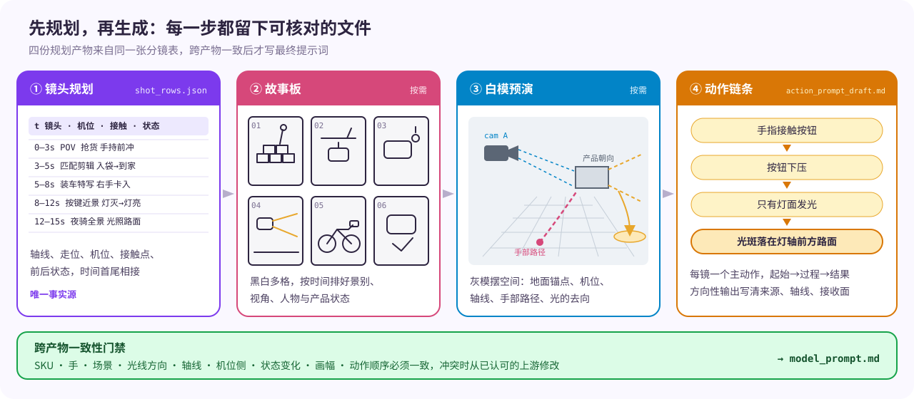
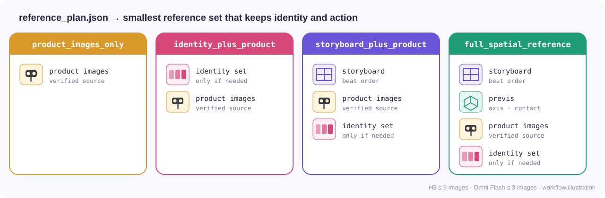
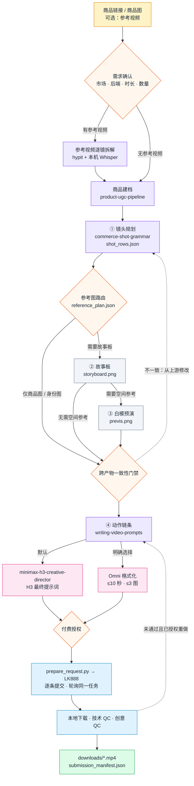

**简体中文** · [English](README.en.md)

<p align="center"></p>

<p align="center">
  <a href="LICENSE"></a>
  
  
  
  
</p>

> 把商品链接和参考视频，变成外观不走样、动作因果正确、已在本地验收的带货视频。

AdMuse 是一个 Agent Skill 编排流程，本身不生成画面。它在花钱生成之前，先把一条视频拆成**镜头规划、故事板、白模预演和动作链条**四份可核对的规划文件，逐项对齐后才写最终提示词。默认调用 MiniMax H3，明确指定时可改用 Omni Flash（单条最长 10 秒）。

<p align="center"></p>

## 核心亮点

### 1. 参考视频逐镜拆解

给了参考视频时，先读懂再创作。hypit 下载视频、探测时长和画幅、找候选切点并抽帧，再对照画面确认真实剪辑点；本机 Whisper `large-v3-turbo` 离线转录原语言台词，保留逐词时间。

每个镜头记录起止时间、景别、画幅、机位角度、构图、运镜方式与速度、焦点、光线方向、转场方式、台词、音效与字幕，并标明“保留什么、替换成我的产品什么”。

**产出**：`reference_analysis.json` 和 `reference_analysis.md`，即逐镜复刻蓝图。

### 2. 镜头规划

`commerce-shot-grammar` 为每个镜头决定轴线、走位、机位与运动、产品朝向、哪只手接触产品哪个位置、动作前后产品处于什么状态，以及环境锚点和光线方向。各镜头时间首尾相接，总和等于目标时长。

这张分镜表是唯一事实源，故事板、白模预演和提示词都从它派生，不会出现第二份互相矛盾的镜头表。

**产出**：`shot_rows.json`。

### 3. 故事板

把分镜表画成黑白多格故事板，按时间顺序排出每个镜头的景别、视角、人物和产品状态，用来锁定“先发生什么、后发生什么”。它是视觉参考，不替代分镜表。

**产出**：`storyboard.png`（按需生成）。

### 4. 白模预演（previs）

用不带材质的灰色白模摆出空间关系：地面锚点、产品与人物位置、手部路径、机位、轴线和画面安全区。白模沿用故事板里的 SKU、手、背景、机位侧、光线方向和产品朝向，不是另外画的一张图。

手与产品接触、安装、光/风/喷雾的方向或复杂运镜容易出错时才生成白模；简单镜头不做。

**产出**：`previs.png`（按需生成）。

### 5. 动作链条

`writing-video-prompts` 把分镜表改写成动作与物理草稿：每个镜头只有一个主动作，写清起始、过程和结果，并按因果顺序排列。以自行车灯为例：

```text
手指接触按钮 → 按钮下压 → 只有灯面发光 → 光斑落在灯轴前方的路面上
```

灯身背后、侧面或画面边缘不能凭空出现光。风扇、喷雾、屏幕、磁吸配件同样按“发出点 → 朝向 → 轴线 → 接收面 → 可见结果”约束。

**产出**：`action_prompt_draft.md`。它是与模型无关的草稿，不直接提交。

### 6. 跨产物一致性门禁

写最终提示词之前，逐项比对 SKU、手、场景、光线方向、轴线、机位侧、状态变化、画幅和动作顺序。冲突时以已认可的上游产物为准修改下游，不凭空发明第三种状态。上游一旦改动，下游按版本和哈希失效，不会沿用过期的故事板或提示词。

### 7. 智能参考图路由

每条变体生成一份 `reference_plan.json`，挑选能保住外观和动作的最小参考图组合。商品简单、原图已能看清外观、动作一看就懂时，只引用几张原图；外形易混或动作复杂时，才加入身份图、故事板或白模预演。没选用的产物记为 `not_required` 并写明原因。

<p align="center"></p>

| 模式 | 适用情况 |
|---|---|
| `product_images_only` | 原图已能看清外观，状态单一，动作一看就懂 |
| `identity_plus_product` | 外形易混淆、多面可见，或有状态敏感的部件 |
| `storyboard_plus_product` | 多个有意义的镜头，或产品揭晓、证明过程靠文字难以保留 |
| `full_spatial_reference` | 手与产品接触、安装、轴线、光/风/喷雾方向或复杂运镜会影响结果 |

生成的身份图如果改变了 SKU、结构、朝向或按键位置，就丢弃它，改用核实过的原图。

### 8. 付费安全与双重 QC

一次只提交一条：提交前写好 `submission.json`，拿到任务 ID 立即记录；结果不明时先查已有任务，不重复提交。下载先写 `.part`，校验通过再改名为 `.mp4` 并记录 SHA-256。

技术 QC 检查编码、时长、尺寸、帧率和音轨；创意 QC 抽查动作前、接触瞬间、状态变化、证明结果和结尾帧。已提交、远端完成、已下载、技术通过、创意通过分开计数，技术成功不等于创意通过。

## 工作流程



| 阶段 | 负责 | 产出 | 通过条件 |
|---|---|---|---|
| 需求确认 | `ad-muse` | `pipeline_manifest.json` | 市场与语言、后端、时长、画幅、数量已确定 |
| 参考拆解（可选） | `hypit` + 本机 Whisper | `reference_analysis.json`、`transcript.json` | 每个镜头都有时间、镜头语言和证据帧 |
| 商品建档 | `product-ugc-pipeline` | `product_brief.json`、`product_reference_set/` | 外观、结构、按键和可支持的状态都有图片或来源佐证 |
| 镜头规划 | `commerce-production-workflow` + `commerce-shot-grammar` | `shot_rows.json` | 时间连续，每镜都有机位、接触点和前后状态 |
| 参考图路由 | `ad-muse` | `reference_plan.json` | 每张选中的图都有角色、哈希和理由 |
| 故事板 / 白模预演（按需） | `commerce-production-workflow` | `storyboard.png`、`previs.png` | 与分镜表一致，通过跨产物门禁 |
| 动作链条 | `writing-video-prompts` | `action_prompt_draft.md` | 每镜一个主动作，因果顺序可见 |
| 最终提示词 | `minimax-h3-creative-director` 或 Omni 格式化 | `model_prompt.md` | 时长、图数、字符数、图片角色符合后端限制 |
| 提交 | `prepare_request.py` → LK888 | `submission_manifest.json` | 付费已授权，一次一条，轮询同一任务 |
| 验收 | `ad-muse` | `downloads/*.mp4`、`qc/` | 技术 QC 与创意 QC 分别判定 |

参考视频与产出数量：N 个参考、要 M 条视频时，每个参考分到 ⌊M/N⌋ 条，前 M mod N 个参考各多 1 条；M < N 时只用前 M 个。例如 10 个参考产出 20 条，就是每个参考 2 条。

## 快速开始

```bash
git clone https://github.com/peipeijiang/ad-muse.git
cd ad-muse
python3 install.py --check   # 只检测，不安装
python3 install.py           # 补装缺失的 Skill，已存在的跳过
```

安装后在 Codex 或 Claude Code 中调用：

```text
$ad-muse 用这个 1688 链接做 5 条墨西哥西语视频，15 秒，9:16，768P。
参考视频：https://www.tiktok.com/@xxx/video/123 、https://www.tiktok.com/@yyy/video/456
```

付费生成需要你自己的 LK888/upDrama 账号，密钥通过环境变量 `LK888_API_KEY` 提供。商品图分析由当前 Agent 的多模态大模型直接看图完成，不需要额外的视觉 API 或密钥。没有付费授权时，AdMuse 只输出可审阅的规划文件、提示词和请求文件。

## 模型后端

| 后端 | 时长 | 参考图 | 提示词 | 何时使用 |
|---|---|---|---|---|
| `minimax-h3` | 4–15 秒，24 FPS | 最多 9 张 | ≤7000 字符 | 默认 |
| `omni-flash` / `omni_flash-10s` | ≤10 秒 | 最多 3 张 | ≤4000 字符 | 用户明确选择 |

两个后端共用同一份分镜表、商品简报和参考图，只有最终提示词、参考图选择和请求格式不同。选了 Omni Flash 却要求 15 秒时，AdMuse 不会静默截短或换模型，而是先拆成多段方案或请你调整需求。

## 依赖

`install.py` 依次检查 `~/.agents/skills` 和 `~/.codex/skills`。已有的 Skill 一律跳过、不覆盖；缺失的按下表补装到 `~/.agents/skills`。

| Skill | 职责 | 来源 |
|---|---|---|
| `ad-muse` | 总编排、参考图路由、提交与验收 | 本仓库 |
| `commerce-production-workflow` | 生产顺序、故事板与白模预演、跨产物 QC | 本仓库 |
| `commerce-shot-grammar` | 轴线、走位、机位、接触与状态 | 本仓库 |
| `product-ugc-pipeline` | 商品抓取、素材清单、商品简报、身份参考图 | [peipeijiang/product-ugc-pipeline](https://github.com/peipeijiang/product-ugc-pipeline) |
| `writing-video-prompts` | 与模型无关的动作和物理草稿 | [SupercmoHQ/superCMO-skills](https://github.com/SupercmoHQ/superCMO-skills) |
| `minimax-h3-*`（6 个） | H3 路由、参考/文本/首尾帧/多镜头提示词与审查 | [unknowlei/minimax-h3-opencode-skills](https://github.com/unknowlei/minimax-h3-opencode-skills) |
| `h3-prompt-writing` | H3 官方提示词语法 | [MiniMax-AI/MiniMax-H3](https://github.com/MiniMax-AI/MiniMax-H3) |
| `hypit` | 参考视频下载与解析 | [hypit-ai/hypit](https://github.com/hypit-ai/hypit) |

本地工具只检测不安装：`git`、`ffmpeg`、`ffprobe` 必需；`hypit` CLI 用于参考视频模式（`npm install -g @hypit/hypit`）；Whisper 需要能 `import whisper` 的 Python 和已缓存的权重。加 `--verify-asr-hash` 可校验 large-v3-turbo 的官方 SHA-256，加 `--json` 输出机器可读结果。

## 许可

[MIT](LICENSE)。第三方 Skill 的来源与许可证见 [NOTICE.md](NOTICE.md)。
