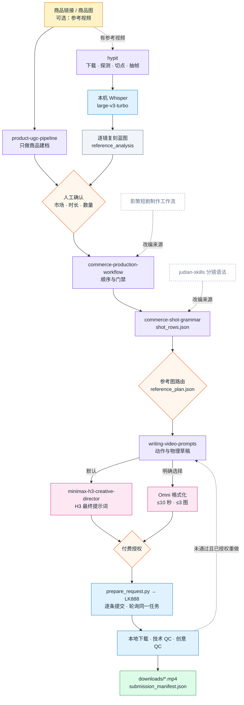

**简体中文** · [English](README.en.md)

<p align="center"></p>

<p align="center">
  <a href="LICENSE"></a>
  
  
  
  
</p>

AdMuse 是一个 Agent Skill 编排流程。它把商品链接和可选的参考视频，交给一组分工明确的 Skill，产出商品外观一致、动作因果正确的 9:16 带货视频，并在本地完成下载与验收。

它本身不是视频模型。默认调用 MiniMax H3，明确指定时也可以用 Omni Flash（单条最长 10 秒）。

## 快速开始

```bash
git clone https://github.com/peipeijiang/ad-muse.git
cd ad-muse
python3 install.py --check   # 只检测，不安装
python3 install.py           # 补装缺失的 Skill，已存在的跳过
```

安装后在 Codex 或 Claude Code 中调用：

```text
$ad-muse 用这个 1688 链接做 5 条墨西哥西语视频，15 秒，9:16，768P。
参考视频：https://www.tiktok.com/@xxx/video/123 、https://www.tiktok.com/@yyy/video/456
```

付费生成需要你自己的 LK888/upDrama 账号，密钥通过环境变量提供（`LK888_API_KEY`；商品图分析使用 `LAOZHANG_API_KEY`）。没有付费授权时，AdMuse 只输出可审阅的提示词和请求文件。

## 工作流程



每个环节只产出一份正式文件，下游在上游文件上标注，不另起一份：一份商品简报、一份 `shot_rows.json`、每条变体一份 `model_prompt.md`。分镜图、previs 和身份图按需生成，不需要时在清单中记录 `not_required` 和原因。

## 参考视频复刻

给了参考视频时，AdMuse 先读懂再写创意：

- **下载与切点**：hypit 下载、探测时长与画幅、找候选切点并抽帧，再人工核对真实剪辑点。
- **语音**：用本机已安装的 Whisper `large-v3-turbo` 转录原语言，保留分段、逐词时间和概率；不自动下载任何模型。
- **逐镜蓝图**：每个镜头记录时间、景别、画幅、机位角度、构图、运镜与速度、焦点、光线方向、转场、台词、环境声与字幕，以及“保留什么、替换什么”。
- **数量分配**：N 个参考、要 M 条视频时，每个参考分到 ⌊M/N⌋ 条，前 M mod N 个参考各多 1 条；M < N 时只用前 M 个。例如 10 个参考产出 20 条，就是每个参考 2 条。

## 参考图路由

<p align="center"></p>

路由器为每条变体选出能保住外观和动作的最小参考图组合（工作流示意）：

| 模式 | 适用情况 |
|---|---|
| `product_images_only` | 原图已能看清外观，状态单一，动作一看就懂 |
| `identity_plus_product` | 外形易混淆、多面可见，或有状态敏感的部件 |
| `storyboard_plus_product` | 多个有意义的镜头，或产品揭晓、证明过程靠文字难以保留 |
| `full_spatial_reference` | 手与产品接触、安装、轴线、光/风/喷雾方向或复杂运镜会影响结果 |

生成的身份图如果改变了 SKU、结构、朝向或按键位置，就丢弃它，改用核实过的原图。

## 模型后端

| 后端 | 时长 | 参考图 | 提示词 | 何时使用 |
|---|---|---|---|---|
| `minimax-h3` | 4–15 秒，24 FPS | 最多 9 张 | ≤7000 字符 | 默认 |
| `omni-flash` / `omni_flash-10s` | ≤10 秒 | 最多 3 张 | ≤4000 字符 | 用户明确选择 |

选了 Omni Flash 却要求 15 秒时，AdMuse 不会静默截短或换模型，而是先拆成多段方案或请你调整需求。

## 物理因果约束

带方向性输出的产品，提示词会写清楚因果链和几何关系。以车灯为例：手按下按钮 → 按钮下压 → 只有灯面发光 → 被照亮的区域在灯轴前方的地面或墙面上。风扇、喷雾、屏幕、磁吸配件也按同样方式约束来源、方向和接收面。

## 交付与验收

- **逐条提交**：每次请求前写好 `submission.json`，拿到任务 ID 立即记录；结果不明时先查已有任务，不重复提交。
- **下载**：先写 `.part`，校验后再改名为 `.mp4`，记录 SHA-256。
- **两道 QC**：技术 QC 检查编码、时长、尺寸、帧率和音轨；创意 QC 抽查开场、动作、证明和结尾帧，检查 SKU、手部、光线方向、语言和因果顺序。
- **分开汇报**：已提交、远端完成、已下载、技术通过、创意通过分别计数，技术成功不等于创意通过。

## 依赖

`install.py` 依次检查 `~/.agents/skills` 和 `~/.codex/skills`。已有的 Skill 一律跳过、不覆盖；缺失的按下表补装到 `~/.agents/skills`。

| Skill | 职责 | 来源 |
|---|---|---|
| `ad-muse` | 总编排 | 本仓库 |
| `commerce-production-workflow` | 生产顺序、门禁、跨产物 QC | 本仓库（改编） |
| `commerce-shot-grammar` | 轴线、走位、机位、接触与状态 | 本仓库（改编） |
| `product-ugc-pipeline` | 商品抓取、素材清单、商品简报、身份参考图 | [peipeijiang/product-ugc-pipeline](https://github.com/peipeijiang/product-ugc-pipeline) |
| `writing-video-prompts` | 与模型无关的动作和物理草稿 | [SupercmoHQ/superCMO-skills](https://github.com/SupercmoHQ/superCMO-skills) |
| `minimax-h3-*`（6 个） | H3 路由、参考/文本/首尾帧/多镜头提示词与审查 | [unknowlei/minimax-h3-opencode-skills](https://github.com/unknowlei/minimax-h3-opencode-skills) |
| `h3-prompt-writing` | H3 官方提示词语法 | [MiniMax-AI/MiniMax-H3](https://github.com/MiniMax-AI/MiniMax-H3) |
| `hypit` | 参考视频下载与解析 | [hypit-ai/hypit](https://github.com/hypit-ai/hypit) |

本地工具只检测不安装：`git`、`ffmpeg`、`ffprobe` 必需；`hypit` CLI 用于参考视频模式（`npm install -g @hypit/hypit`）；Whisper 需要能 `import whisper` 的 Python 和已缓存的权重。加 `--verify-asr-hash` 可校验 large-v3-turbo 的官方 SHA-256，加 `--json` 输出机器可读结果。

## 许可

[MIT](LICENSE)。改编内容的来源和第三方 Skill 的许可证见 [NOTICE.md](NOTICE.md)。
